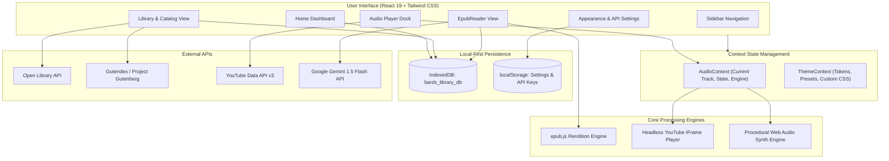

# Bard's Library 📖 🎵

> Distraction-free desktop e-reader and ambient soundscape workspace engineered for deep reading, study sessions, and literary exploration.

[](https://github.com)
[](https://react.dev/)
[](https://www.typescriptlang.org/)
[](https://www.electronjs.org/)
[](https://tailwindcss.com/)
[](LICENSE)

---

## Overview

**Bard's Library** merges an offline-first EPUB reading engine with a native audio dock, a multi-source book discovery catalog, and an integrated Gemini literary assistant. It solves the friction of juggling separate e-reader apps, YouTube tabs, and browser windows by bringing reading, soundscapes, and AI matchmaking into a single desktop application.

Whether you are studying classic literature with classical piano, reading web novels with ambient rain synthesis, or managing personal EPUB libraries on a flight, Bard's Library delivers a focused, tactile reading experience.

---

## Key Features

### 🏠 Dedicated Home Dashboard
- **Reading Progress Analytics**: Tracks total hours read and day streaks locally using IndexedDB.
- **Continue Reading Hero**: Resume your active book with a single click, showing real-time chapter and percentage progress.
- **Soundscape Lounge**: One-touch playback triggers for ambient study environments directly from the dashboard.
- **Categorized Discovery Shelves**: Curated sections for Manga & Webtoons, Light Novels & Fantasy, Classics, and Biographies.

### 🌐 Multi-Source Catalog & Smart EPUB Importer
- **70,000+ Titles via Parallel APIs**: Real-time integration with Open Library and Gutendex for world literature, modern fiction, light novels, and biography search.
- **Instant Web Novel & Manga Indexing**: Pre-indexed metadata for popular series like *The Beginning After the End*, *Solo Leveling*, *Omniscient Reader's Viewpoint*, *Tower of God*, and *Berserk*.
- **1-Click Download for Open-Access Works**: Immediate binary download of public domain titles into local storage.
- **Direct Web Link Importer**: Paste direct `.epub` links from Standard Ebooks, Archive.org, or online mirrors for instant download and reading.
- **Drag-and-Drop Local Files**: Load any personal `.epub` from your local machine with automatic cover color and metadata extraction.

### 🎵 Curated Soundscapes & Procedural Audio
- **Curated Instrumental Soundtracks**: Smooth acoustic guitar, ambient piano, neo-classical cello, Studio Ghibli instrumentals, smooth coffeehouse jazz, and lofi chill.
- **Procedural Web Audio Synthesizers**: Zero-network client-side synthesis for gentle rain, hearth fire crackle, and deep cosmic drones.
- **Persistent Audio Dock**: Global playback controls with volume sliders, playlist cycling, and track search that stay active across all views.

### 🤖 AI Literary Matchmaker & Reading Companion
- **Google Gemini Integration**: Powered by `gemini-1.5-flash` with zero-key offline heuristic fallback.
- **Soundtrack Matchmaker**: Select or type moods (*Cozy Study*, *Melancholic Rain*, *Epic Fantasy*, *Gothic Dark*, *Peaceful Forest*, *Cyberpunk Synth*) to generate 3 mood-calibrated instrumental recommendations with a 1-click **Play in Dock** button.
- **End-of-Book Next-Read Matchmaker**: Automatically triggers upon completing a chapter or book (>95% progress) to recommend kindred books, manga, and series with a 1-click **Find in Catalog** shortcut.
- **Highlight-to-Music**: Select any passage in the reader to generate tailored ambient music matching that exact scene.

### 💾 Local-First Storage (IndexedDB)
- **Zero Account Requirement**: Reading data, bookmarks, and highlights stay private on your local disk.
- **Binary Blob Caching**: Downloaded EPUB files are stored as binary Blobs in IndexedDB (`bards_library_db`), guaranteeing full offline accessibility.

### 🎨 Custom Desktop Branding & Windows Taskbar Icon
- **Vector Harp & Bookmark Emblem**: Official insignia combining an open book base, golden concert harp, and crimson bookmark ribbon.
- **Windows Taskbar Integration**: Configured with `AppUserModelId` (`com.bardslibrary.app`) and multi-resolution `icon.ico` (16x16 to 256x256) for crisp rendering on Windows 10/11 taskbars, titlebars, and desktop shortcuts.

---

## Content Formats & Catalog Coverage

| Format | Availability & Ingestion Method | Notes |
|---|---|---|
| **Classics & World Literature** | Built-in Online Catalog (70,000+ Gutendex / Gutenberg titles) | Public domain; 1-click download directly into offline IndexedDB. |
| **Biographies & Memoirs** | Built-in Online Catalog + Open Library Search | Historical and contemporary autobiographies with immediate metadata and reading stats. |
| **Light Novels & Web Fiction** | Open Library API + Embedded Index + Direct Web Importer | Instant metadata search for popular series; paste direct mirror links or drop local files to read. |
| **Manga & Manhwa Adaptations** | Open Library API + Direct URL Importer + Drag-and-Drop | Indexed metadata for popular series. Commercial copyrighted titles load via local drag-and-drop or web EPUB import. |

---

## Tech Stack

| Layer | Technology | Purpose |
|---|---|---|
| **Desktop Runtime** | Electron `44.7.2` | Native desktop window lifecycle and IPC |
| **Frontend Framework** | React `19.1.0` | Declarative UI rendering |
| **Language** | TypeScript `~6.0.3` | Strict type safety and contracts |
| **Build & Dev Tool** | Vite `8.3.4` | Fast HMR and Rollup-based production bundler |
| **Styling** | Tailwind CSS `v4.3.3` | Modern utility styling and CSS variable tokens |
| **Icons** | Lucide React `1.57.0` | Minimalist interface iconography |
| **E-Reader Core** | epubjs `0.3.93` | EPUB file parsing, layout flow, and pagination |
| **Local Database** | IndexedDB | Offline binary book blob and reading statistics storage |
| **Music Streaming** | YouTube Data API v3 + IFrame API | Global music catalog search and headless playback |
| **Audio Synthesis** | Web Audio API | Zero-asset client-side procedural sound generation |
| **AI Assistant** | Google Gemini API (`gemini-1.5-flash`) | Contextual literary analysis and soundtrack matchmaking |
| **Packaging** | electron-builder `26.15.3` | Windows portable and NSIS installer compilation |

---

## System Architecture



---

## Project Structure

```
Bard's Library/
├── build/
│   ├── icon.ico                 # Multi-resolution Windows application icon (16x16 to 256x256)
│   ├── icon.png                 # 256x256 high-resolution icon
│   └── icon-512.png             # 512x512 master icon
├── electron/
│   └── main.cjs                 # Electron main process (window lifecycle, taskbar icon, CSP)
├── public/
│   ├── books/                   # Bundled starter public domain EPUB files
│   │   ├── alice.epub
│   │   └── frankenstein.epub
│   ├── icon.ico                 # Web favicon (ICO)
│   ├── icon.png                 # Web favicon (PNG)
│   └── icon.svg                 # Web favicon (SVG)
├── scripts/
│   └── generate-icons.cjs       # Node script to render vector icons to ICO and PNG formats
├── src/
│   ├── components/
│   │   ├── common/
│   │   │   └── BardsLogo.tsx    # Official vector Harp and Bookmark insignia
│   │   ├── home/
│   │   │   └── HomeView.tsx     # Home dashboard (stats, resume reading, discovery shelves)
│   │   ├── layout/
│   │   │   ├── AppLayout.tsx    # Master app shell, sidebar grid, and bottom audio dock
│   │   │   ├── AudioPlayer.tsx  # Dock player, search dialog, scrubber, and synth triggers
│   │   │   └── Sidebar.tsx      # View navigation, branding, and audio status
│   │   ├── library/
│   │   │   └── LibraryView.tsx  # Online catalog, genre chips, and local shelf grid
│   │   ├── reader/
│   │   │   ├── EpubReader.tsx   # epub.js canvas, typography bar, bookmarks, Gemini drawer
│   │   │   └── ReaderView.tsx   # Reader route view wrapper
│   │   └── settings/
│   │       └── ThemeSettings.tsx# Theme preset picker, token sliders, CSS injector, API keys
│   ├── context/
│   │   ├── AudioContext.tsx     # Global audio state, YouTube IFrame lifecycle, synth routing
│   │   └── ThemeContext.tsx     # CSS variables injection, preset states, typography tokens
│   ├── services/
│   │   ├── ambientAudioEngine.ts# Web Audio API procedural synthesizer (Rain, Fire, Drone)
│   │   ├── geminiService.ts     # Google Gemini API client for literary analysis
│   │   ├── offlineDb.ts         # IndexedDB operations (books, blobs, bookmarks, stats)
│   │   ├── onlineBookService.ts # Multi-source Open Library + Gutendex search and indexing
│   │   ├── storageService.ts    # Reading progress and CFI state persistence
│   │   └── youtubeService.ts    # YouTube Data API v3 search and curated track definitions
│   ├── App.tsx                  # HashRouter routing setup
│   ├── index.css                # Tailwind CSS v4 directives and root CSS variables
│   └── main.tsx                 # React application entry point
├── .env.example                 # Template for API keys
├── package.json                 # Project dependencies, build scripts, and electron-builder config
├── tsconfig.json                # TypeScript compiler configuration
└── vite.config.ts               # Vite bundler and Tailwind CSS plugin configuration
```

---

## Prerequisites

- **Node.js**: `v20.0.0` or higher ([Download Node.js](https://nodejs.org/))
- **npm**: `v10.0.0` or higher (packaged with Node.js)
- **Operating System**: Windows 10/11 (for generating Windows `.exe` binaries), or macOS/Linux for development preview.

---

## Getting Started

### 1. Clone the Repository
```bash
git clone https://github.com/your-username/bards-library.git
cd "bards-library"
```

### 2. Install Dependencies
```bash
npm install
```

### 3. Configure Environment Variables
Copy `.env.example` to create your local `.env`:
```bash
cp .env.example .env
```

Open `.env` and configure your API keys:
```env
# Google Gemini API Key (for literary assistant)
VITE_GEMINI_API_KEY=your_gemini_api_key_here

# YouTube Data API v3 Key (for custom music searches)
VITE_YOUTUBE_API_KEY=your_youtube_api_key_here
```

> **Note**: API keys are completely optional. Offline reading, procedural synthesizers, and default curated soundscapes work out of the box without any keys. Keys can also be entered directly inside the application under **Settings -> API Keys**.

### 4. Run Development Server
```bash
npm run dev
```
Open `http://localhost:5173` in your browser.

---

## Building Desktop Binaries

Bard's Library uses `electron-builder` with maximum LZMA2 compression to produce compact Windows executables.

### Build Standalone Portable `.exe`
```bash
npm run package:exe
```
- Output: `release/Bard's Library 1.0.0.exe` (~100 MB)
- Portable executable with embedded custom icon. Double-click to run on any Windows system with zero installation.

### Build Windows Installer (NSIS Setup)
```bash
npm run package:setup
```
- Output: `release/Bard's Library Setup 1.0.0.exe` (~112 MB)
- Includes desktop shortcut creation, start menu integration, and uninstaller.

---

## E-Reader Keyboard Shortcuts

| Shortcut | Action |
|---|---|
| `Left Arrow` / `Page Up` | Turn to previous page |
| `Right Arrow` / `Page Down` / `Space` | Turn to next page |
| `Text Selection` | Show floating literary analysis quick action |
| `Escape` | Dismiss modal dialogs or analysis popups |

---

## Offline Capabilities

- **Offline Reading**: Bundled and imported `.epub` files are saved directly into IndexedDB. The app opens and functions without an internet connection.
- **Offline Synthesizers**: Built-in procedural Web Audio synthesis algorithms generate continuous rain, hearth fire, and space drones with zero external audio assets or network requests.
- **Progress Persistence**: Reading position (EPUB CFI) and daily reading duration are continuously saved locally.

---

## Contributing

Contributions are welcome:

1. Fork the Project
2. Create your Feature Branch (`git checkout -b feature/NewFeature`)
3. Commit your Changes (`git commit -m "feat: add new feature"`)
4. Push to the Branch (`git push origin feature/NewFeature`)
5. Open a Pull Request

---

## License

Distributed under the MIT License. See [LICENSE](LICENSE) for more information.
