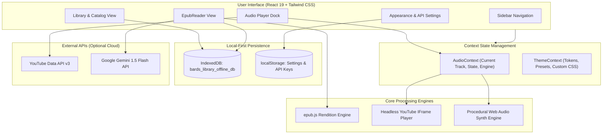

# Bard's Library 📖 🎵

> A distraction-free desktop e-reader and ambient music workspace engineered for deep reading, study sessions, and literary exploration.

[](https://github.com)
[](https://react.dev/)
[](https://www.typescriptlang.org/)
[](https://www.electronjs.org/)
[](https://tailwindcss.com/)
[](LICENSE)

---

## Overview

**Bard's Library** merges an offline-first EPUB reading engine with a native audio dock and an integrated Gemini literary assistant. It solves the friction of managing separate reading apps, background music tabs, and research tools by unifying them into a single, cohesive desktop environment.

Whether you are studying classic literature with synchronized classical piano, working through textbooks accompanied by 24/7 lofi beats, or reading offline on a flight with procedural rain synthesis, Bard's Library provides a focused, tactile reading experience.

---

## Key Features

### 🌐 Global Online Catalog & Web EPUB Importer
- **70,000+ Online Books, Manga Adaptations & Light Novels**: Search Gutenberg and open web libraries via live REST integration with Gutendex. Filter across Manga & Comics, Light Novels, Manhwa & Asian Fiction, Biographies & Memoirs, Novels & Classics, Sci-Fi & Cyberpunk, Mystery, and Philosophy.
- **1-Click Download & Read**: Download online titles directly into local IndexedDB for permanent offline access.
- **Direct Web Link Importer**: Paste any CORS-accessible `.epub` link from Standard Ebooks, Archive.org, or online light novel / webtoon mirrors to download and read immediately.
- **Local File Drag-and-Drop**: Load any personal `.epub` file directly from your computer with automated metadata parsing.

### 🤖 AI Soundtrack & Next-Read Matchmaker
- **Dedicated Reading Companion**: Built with Google Gemini (`gemini-1.5-flash`) with full zero-key / offline fallback support. Replaces generic chatbot banter with focused literary matchmaking.
- **Book-Matched Soundtrack Matchmaker**: Select or type customizable moods (*Cozy Study*, *Melancholic Rain*, *Epic Fantasy*, *Gothic Dark*, *Peaceful Forest*, *Cyberpunk Synth*). Recommends 3 curated, mood-calibrated instrumental tracks with 1-click **Play in Dock** button that immediately queues and plays the audio in the bottom player dock.
- **End-of-Book Next-Read Matchmaker**: Suggests kindred books, manga, and series when finishing a chapter or book (>95% progress). Filter by format (*Manga*, *Light Novel*, *Manhwa*, *Biography*, *Novel*) with 1-click **Find in Catalog** to instantly search the online open library.
- **Highlight-to-Music**: Select any evocative passage in the text to instantly generate book-matched ambient music matching the emotional tone of that exact scene.

### 💾 Local-First Storage (IndexedDB)
- **Zero Account Requirement**: Books and reading data remain on your local machine.
- **Blob Caching**: Downloaded public domain titles and imported local `.epub` files are stored as binary Blobs in IndexedDB (`bards_library_offline_db`), guaranteeing complete offline availability.

### ⚡ Optimized Performance & Code Splitting
- **Modular Bundles**: Rollup-split chunks for `vendor` (React core), `reader` (epub.js), and `icons` (Lucide) ensuring sub-second startup times and clean memory usage.

### 📦 Windows Executable Distribution
- **Lightweight Distribution**: Chromium language packages pruned and compressed with LZMA2:
  - **Portable Executable**: Standalone `release/Bard's Library 1.0.0.exe` (~100 MB).
  - **Setup Installer**: Configurable NSIS `release/Bard's Library Setup 1.0.0.exe` (~112 MB).

---

## Content Formats & Global Catalog Availability

| Format | Availability & Ingestion Method | Notes |
|---|---|---|
| **Classics & World Literature** | Built-in Online Catalog (70,000+ Gutendex / Gutenberg titles) | Fully public domain; 1-click download directly into offline IndexedDB. |
| **Biographies & Memoirs** | Built-in Online Catalog + Curated Starter Titles | Includes historical autobiographies (Benjamin Franklin, Marcus Aurelius, Ulysses S. Grant). |
| **Light Novels & Web Fiction** | Online Discovery + Direct Web URL Importer | Public domain serialized adventures (Dumas, Verne) + direct EPUB import from web serial archives (Royal Road mirrors, Syosetu translations). |
| **Manga & Comics Adaptations** | Direct Web URL Importer + Local File Dropper | Graphic illustrated classics (Tenniel's *Alice*, Doré's *Inferno*) plus personal EPUB graphic files. Commercial manga (Shueisha, Kodansha) are copyrighted and cannot be pre-bundled legally, but load seamlessly via local drag-and-drop. |
| **Manhwa & Webtoons** | Direct Web URL Importer + AI Matchmaker | Load webtoon EPUB conversions or discover top series through the AI Next-Read Matchmaker with 1-click catalog search. |

---

## Tech Stack

| Layer | Technology | Purpose |
|---|---|---|
| **Desktop Runtime** | Electron `44.7.2` | Native desktop window lifecycle and IPC |
| **Frontend Framework** | React `19.1.0` | Declarative UI rendering |
| **Language** | TypeScript `~6.0.3` | Strict type safety and contracts |
| **Build & Dev Tool** | Vite `8.0.16` | Sub-second HMR and optimized bundler |
| **Styling** | Tailwind CSS `v4.3.3` | Utility styling and CSS variable design tokens |
| **Icons** | Lucide React `1.57.0` | Minimalist line iconography |
| **E-Reader Core** | epubjs `0.3.93` | EPUB file parsing, layout flow, and pagination |
| **Local Database** | IndexedDB | Offline binary book blob and bookmark storage |
| **Music Streaming** | YouTube Data API v3 + IFrame API | Global music catalog search and headless playback |
| **Audio Synthesis** | Web Audio API | Client-side procedural ambient noise generation |
| **AI Assistant** | Google Gemini API | Literary analysis and contextual reading companion |
| **Packaging** | electron-builder `26.15.3` | Windows portable and NSIS installer compilation |

---

## System Architecture



---

## Project Structure

```
Bard's Library/
├── electron/
│   └── main.cjs                 # Electron main process (window lifecycle, CSP, local file handling)
├── public/
│   ├── books/                   # Bundled starter public domain EPUB files
│   │   ├── alice.epub
│   │   └── frankenstein.epub
│   └── vite.svg
├── src/
│   ├── components/
│   │   ├── layout/
│   │   │   ├── AppLayout.tsx    # Master app shell, sidebar grid, and bottom audio dock
│   │   │   ├── AudioPlayer.tsx  # Dock player, search dialog, scrubber, and synth triggers
│   │   │   └── Sidebar.tsx      # View navigation and context audio status badge
│   │   ├── library/
│   │   │   └── LibraryView.tsx  # Editorial book cards, offline filter tabs, EPUB importer
│   │   ├── reader/
│   │   │   ├── EpubReader.tsx   # epub.js canvas, typography bar, bookmarks, Gemini drawer
│   │   │   └── ReaderView.tsx   # Reader route view wrapper
│   │   └── settings/
│   │       └── ThemeSettings.tsx# Theme preset picker, token sliders, CSS injector, API keys
│   ├── context/
│   │   ├── AudioContext.tsx     # Global audio state, YouTube IFrame lifecycle, synth routing
│   │   └── ThemeContext.tsx     # CSS variables injection, preset states, typography tokens
│   ├── services/
│   │   ├── ambientAudioEngine.ts# Web Audio API procedural synthesizer (Rain, Fire, Drone)
│   │   ├── geminiService.ts     # Google Gemini API client for literary analysis
│   │   ├── offlineDb.ts         # IndexedDB operations (save/load books, blobs, bookmarks)
│   │   ├── storageService.ts    # Reading progress and CFI state persistence
│   │   └── youtubeService.ts    # YouTube Data API v3 search and curated track definitions
│   ├── App.tsx                  # HashRouter routing setup
│   ├── index.css                # Tailwind CSS v4 directives and root CSS variables
│   └── main.tsx                 # React application entry point
├── .env.example                 # Template for API keys
├── package.json                 # Project dependencies, build scripts, and electron-builder config
├── tsconfig.json                # TypeScript compiler configuration
└── vite.config.ts               # Vite bundler and Tailwind CSS plugin configuration
```

---

## Prerequisites

Before running or building the project locally, ensure you have:

- **Node.js**: `v20.0.0` or higher ([Download Node.js](https://nodejs.org/))
- **npm**: `v10.0.0` or higher (packaged with Node.js)
- **Operating System**: Windows 10/11 (for generating Windows `.exe` binaries), or macOS/Linux for web preview.

---

## Getting Started

### 1. Clone the Repository
```bash
git clone https://github.com/your-username/bards-library.git
cd "bards-library"
```

### 2. Install Dependencies
```bash
npm install
```

### 3. Configure Environment Variables
Copy `.env.example` to create your local `.env`:
```bash
cp .env.example .env
```

Open `.env` and configure your API keys:
```env
# Google Gemini API Key (for literary assistant)
VITE_GEMINI_API_KEY=your_gemini_api_key_here

# YouTube Data API v3 Key (for search queries)
VITE_YOUTUBE_API_KEY=your_youtube_api_key_here
```

> **Note**: API keys are completely optional for basic offline reading and procedural soundscapes. You can also configure or update these keys directly inside the running application under **Settings → API Keys**.

### 4. Run the Development Server
```bash
npm run dev
```
Open `http://localhost:5173` in your browser.

---

## Building Desktop Binaries

Bard's Library uses `electron-builder` with maximum LZMA2 compression and pruned Chromium language files to produce compact Windows executables.

### Build Standalone Portable `.exe`
```bash
npm run package:exe
```
- Output: `release/Bard's Library 0.1.0.exe` (~100 MB)
- Requires zero installation. Double-click to launch immediately on any Windows machine.

### Build Windows Installer (NSIS Setup)
```bash
npm run package:setup
```
- Output: `release/Bard's Library Setup 0.1.0.exe` (~112 MB)
- Includes desktop shortcut creation, start menu integration, and uninstaller.

---

## Configuration & Environment Variables

| Variable | Required | Description | Fallback Location |
|---|---|---|---|
| `VITE_YOUTUBE_API_KEY` | Optional | YouTube Data API v3 key for searching songs and albums | Settings UI (`localStorage`) |
| `VITE_GEMINI_API_KEY` | Optional | Google Gemini API key for in-reader AI literary analysis | Settings UI (`localStorage`) |

### How to Get Your API Keys

#### 1. YouTube Data API v3
1. Visit the [Google Cloud Console](https://console.cloud.google.com/).
2. Create a new project or select an existing one.
3. Navigate to **APIs & Services → Library**, search for **YouTube Data API v3**, and click **Enable**.
4. Go to **APIs & Services → Credentials** and click **Create Credentials → API Key**.
5. Copy the key and paste it into `.env` as `VITE_YOUTUBE_API_KEY` (or enter it in the app's Settings).

#### 2. Google Gemini API
1. Visit [Google AI Studio](https://aistudio.google.com/).
2. Click **Get API key** and generate a new key.
3. Copy the key and paste it into `.env` as `VITE_GEMINI_API_KEY` (or enter it in the app's Settings).

---

## E-Reader Keyboard Shortcuts

| Shortcut | Action |
|---|---|
| `Left Arrow` / `Page Up` | Turn to previous page |
| `Right Arrow` / `Page Down` / `Space` | Turn to next page |
| `Text Selection` | Show floating literary analysis quick action |
| `Escape` | Dismiss modal dialogs or analysis popups |

---

## Offline Capabilities

Bard's Library is built local-first:
- **Offline Reading**: Bundled and imported `.epub` files are saved directly into your browser's IndexedDB. The app can be opened without an active internet connection to read books and view saved bookmarks.
- **Offline Synthesizers**: Built-in procedural Web Audio synthesis algorithms generate continuous rain, hearth fire, and space drones with zero external audio assets or network requests.
- **Cache Persistence**: Reading progress (EPUB CFI) is continuously saved, so returning to any book instantly restores your exact page location.

---

## Troubleshooting

### YouTube Searches Return Empty Results
- Check that your YouTube Data API v3 key is active in the Google Cloud Console.
- Ensure the YouTube Data API v3 has not exceeded its free daily quota (10,000 units/day).
- If offline, switch to the built-in procedural synthesizers in the audio dock.

### EPUB Rendering / Loading Errors
- Ensure the imported file is a valid, DRM-free `.epub` archive. Files with Adobe DRM or proprietary formats (`.mobi`, `.azw3`) are not supported by standard EPUB readers.

### PowerShell Script Execution Policy on Windows
If `npm` scripts fail with a execution policy warning:
```powershell
Set-ExecutionPolicy -Scope CurrentUser -ExecutionPolicy RemoteSigned
```
Or run commands via Command Prompt (`cmd.exe /c "npm run package:exe"`).

---

## Contributing

Contributions are welcome! Please feel free to open issues or submit pull requests:

1. Fork the Project
2. Create your Feature Branch (`git checkout -b feature/AmazingFeature`)
3. Commit your Changes (`git commit -m 'feat: add some amazing feature'`)
4. Push to the Branch (`git push origin feature/AmazingFeature`)
5. Open a Pull Request

---

## License

Distributed under the MIT License. See [LICENSE](LICENSE) for more information.
